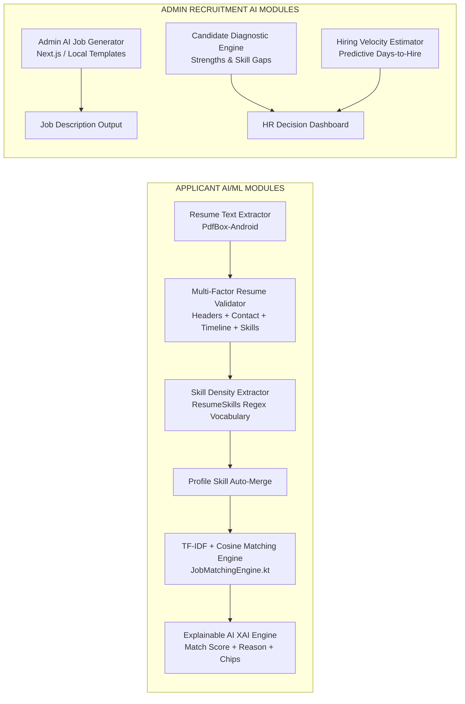
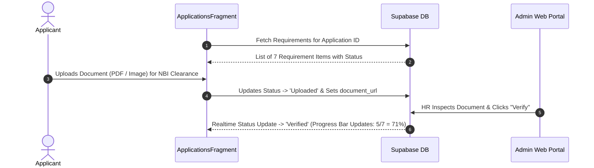

# MR.D.I.Y. Careers — Advanced AI/ML & Pre-Employment Planning Specification

This document provides a comprehensive engineering blueprint for advanced AI/ML features, pre-employment onboarding workflows, hiring velocity estimation, candidate strengths/weaknesses diagnostics, explainable AI ranking, and AI job description generation for the HR Admin portal.

---

## Architecture Overview

---

## Section 1: Pre-Employment Steps & Onboarding Checklist Workflow

### 1.1 Objective
Provide an interactive pre-employment onboarding workflow for candidates who reach the "Shortlisted" or "Hired" stage, guiding them through required pre-employment documents and government compliance steps before day 1 of work.

### 1.2 Requirements Checklist
- SSS Number / E-1 Form
- PhilHealth Member Data Record (MDR)
- Pag-IBIG MID Number / Member Data Form
- NBI Clearance / Police Clearance
- Pre-Employment Medical Exam / Health Permit
- BIR Form 1902 / TIN
- Signed Employment Contract

### 1.3 Data Schema (Supabase PostgreSQL)
Table Name: `public.pre_employment_requirements`
- `id` (UUID, Primary Key, default `gen_random_uuid()`)
- `user_id` (TEXT, Foreign Key -> `profiles.user_id`)
- `application_id` (UUID, Foreign Key -> `applications.id`)
- `requirement_name` (TEXT, e.g., 'NBI Clearance')
- `status` (TEXT: 'Pending', 'Uploaded', 'Verified', 'Rejected')
- `document_url` (TEXT)
- `updated_at` (TIMESTAMPTZ, default `now()`)

### 1.4 Workflow Sequence

---

## Section 2: Hiring Velocity Estimator & Strengths/Weaknesses ML Diagnostic

### 2.1 Hiring Velocity Estimator Algorithm
Predicts estimated turnaround days from application submission to official job offer.

$$\text{Estimated Days} = \text{Base Timeline (7 Days)} + \Delta_{\text{Match}} + \Delta_{\text{Profile}} + \Delta_{\text{Docs}} + \Delta_{\text{Gaps}}$$

- **Base Hiring Timeline:** 7 Business Days
- **Score Adjustments ($\Delta$):**
  - Match Score $\ge 85\%$: $-2$ Days (High urgency priority hire)
  - Complete Profile & Uploaded Resume: $-1$ Day
  - Complete Pre-Employment Documents: $-1$ Day
  - Lacks core skills ($< 50\%$ match): $+3$ Days
  - Experience Level Mismatch: $+2$ Days
- **Output Format:** `"Estimated Hiring Velocity: 2 - 4 Business Days"`

### 2.2 Strengths and Weaknesses ML Diagnostic Engine
Class Name: `CandidateDiagnosticEngine.kt`

#### A. Strengths (Mga Kasanayan at Bentahe):
- Core Skill Matches: Matches between candidate skills and job requirements.
- Experience Fit: Candidate years of experience vs required level.
- Geographic Fit: Lives within Metro Manila branch boundary (`LocationDistance.kt`).
- Example Outputs:
  - `[+]` *"Strong Cash Handling & POS expertise (3+ years)"*
  - `[+]` *"High TF-IDF similarity in Store Management & Inventory Auditing"*
  - `[+]` *"Location match: Pasig City (Branch Proximity ~4.2 km)"*

#### B. Weaknesses / Skill Gaps (Mga Kulang na Kasanayan):
- Missing Core Skills: Key requirements listed in job description missing from candidate profile.
- Missing Certifications: e.g., Forklift license, First Aid certification.
- Example Outputs:
  - `[-]` *"Lacks listed requirement: Forklift Operation Certification"*
  - `[-]` *"No prior experience listed in Visual Merchandising"*

---

## Section 3: Explainable AI (XAI) Ranking Explanation Engine

### 3.1 Objective
Provide transparent, human-readable explanations detailing WHY a candidate was ranked at a specific position and match percentage, eliminating black-box AI mistrust.

### 3.2 Mathematical Model (TF-IDF & Cosine Similarity)

Term Frequency - Inverse Document Frequency (TF-IDF):

$$\text{TF}(t, d) = \frac{f_{t,d}}{\sum_{t' \in d} f_{t',d}}$$

$$\text{IDF}(t, D) = \ln\left( \frac{|D|}{1 + |\{d \in D : t \in d\}|} \right)$$

$$\text{TF-IDF}(t, d, D) = \text{TF}(t, d) \times \text{IDF}(t, D)$$

Cosine Similarity Equation:

$$\text{Cosine Similarity}(\vec{A}, \vec{B}) = \frac{\vec{A} \cdot \vec{B}}{\|\vec{A}\| \|\vec{B}\|} = \frac{\sum_{i=1}^{n} A_i B_i}{\sqrt{\sum_{i=1}^{n} A_i^2} \sqrt{\sum_{i=1}^{n} B_i^2}}$$

### 3.3 XAI Explanation Template Output
> *"Candidate [Name] is ranked at #[Rank] with a [Score]% Match for [Job Title]. This ranking is driven by a [Similarity]% text similarity in [Category] roles, matching [MatchedCount] out of [TotalReqs] primary job requirements ([SkillsList]). Candidate experience of [Years] years aligns with the [Level] requirement."*

---

## Section 4: AI Job Description Generator for Admin Web Portal (`mrdiy-admin`)

### 4.1 Objective
Assist HR Administrators when creating or editing job postings in the Admin Web Portal (`mrdiy-admin`) by automatically generating optimized, retail-ready job descriptions based on the specified job title.

### 4.2 UI & Functionality
- **UI Button:** `✨ Generate AI Description` button next to Description field in `mrdiy-admin/app/jobs/page.tsx`.
- **Input:** Job Title (e.g., *"Store Supervisor"*, *"Warehouse Crew"*, *"Cashier"*, *"HR Officer"*).
- **Template Output Structure:**
  - About the Role
  - Key Responsibilities
  - Requirements
  - Benefits
