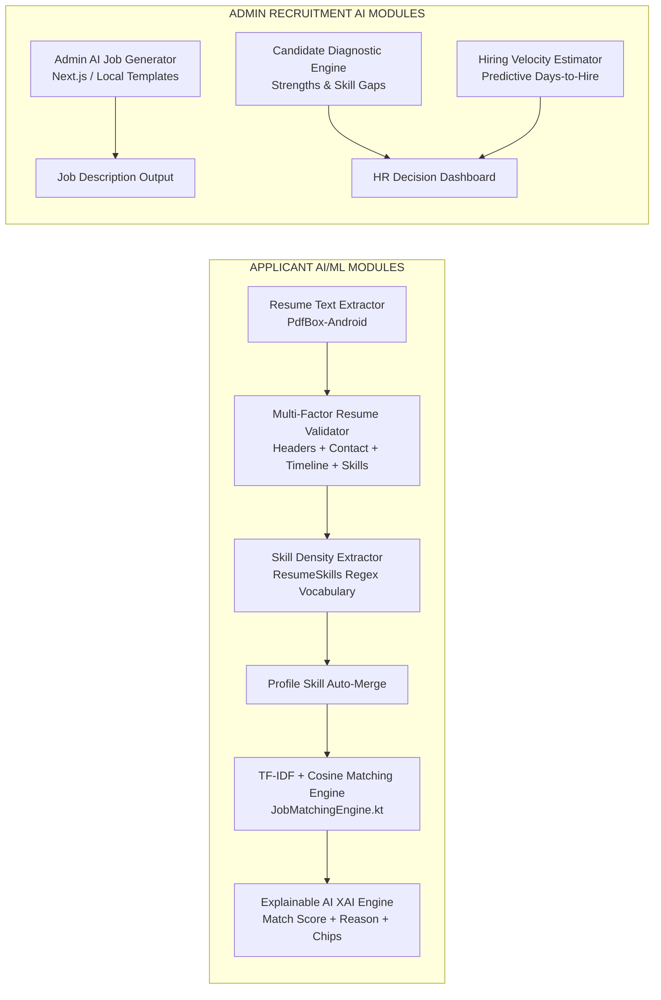
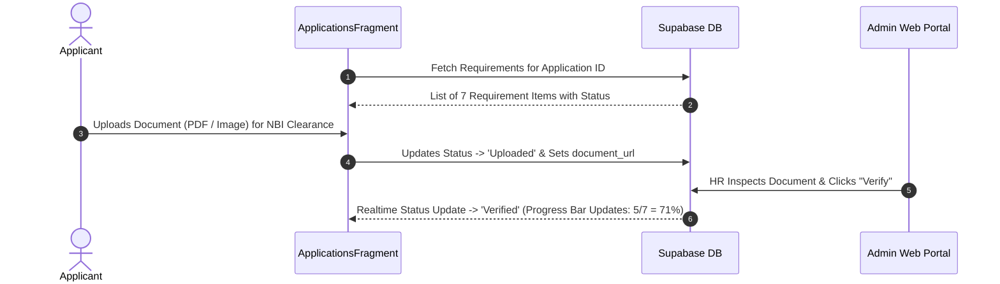

# MR.D.I.Y. Careers — Advanced AI/ML & Pre-Employment Planning Specification

This document provides a comprehensive engineering blueprint for advanced AI/ML features, pre-employment onboarding workflows, hiring velocity estimation, candidate strengths/weaknesses diagnostics, explainable AI ranking, and AI job description generation for the HR Admin portal.

---

## Architecture Overview



---

## Section 1: Pre-Employment Steps & Onboarding Checklist Workflow

### 1.1 Objective
Provide an interactive pre-employment onboarding workflow for candidates who reach the "Shortlisted" or "Hired" stage, guiding them through required pre-employment documents and government compliance steps before day 1 of work.

### 1.2 Requirements Checklist
- SSS Number / E-1 Form
- PhilHealth Member Data Record (MDR)
- Pag-IBIG MID Number / Member Data Form
- NBI Clearance / Police Clearance
- Pre-Employment Medical Exam / Health Permit
- BIR Form 1902 / TIN
- Signed Employment Contract

### 1.3 Data Schema (Supabase PostgreSQL)
Table Name: `public.pre_employment_requirements`
- `id` (UUID, Primary Key, default `gen_random_uuid()`)
- `user_id` (TEXT, Foreign Key -> `profiles.user_id`)
- `application_id` (UUID, Foreign Key -> `applications.id`)
- `requirement_name` (TEXT, e.g., 'NBI Clearance')
- `status` (TEXT: 'Pending', 'Uploaded', 'Verified', 'Rejected')
- `document_url` (TEXT)
- `updated_at` (TIMESTAMPTZ, default `now()`)

### 1.4 Workflow Sequence


---

## Section 2: Hiring Velocity Estimator & Strengths/Weaknesses ML Diagnostic

### 2.1 Hiring Velocity Estimator Algorithm
Predicts estimated turnaround days from application submission to official job offer.

$$\text{Estimated Days} = \text{Base Timeline (7 Days)} + \Delta_{\text{Match}} + \Delta_{\text{Profile}} + \Delta_{\text{Docs}} + \Delta_{\text{Gaps}}$$

- **Base Hiring Timeline:** 7 Business Days
- **Score Adjustments ($\Delta$):**
  - Match Score $\ge 85\%$: $-2$ Days (High urgency priority hire)
  - Complete Profile & Uploaded Resume: $-1$ Day
  - Complete Pre-Employment Documents: $-1$ Day
  - Lacks core skills ($< 50\%$ match): $+3$ Days
  - Experience Level Mismatch: $+2$ Days
- **Output Format:** `"Estimated Hiring Velocity: 2 - 4 Business Days"`

### 2.2 Strengths and Weaknesses ML Diagnostic Engine
Class Name: `CandidateDiagnosticEngine.kt`

#### A. Strengths (Mga Kasanayan at Bentahe):
- Core Skill Matches: Matches between candidate skills and job requirements.
- Experience Fit: Candidate years of experience vs required level.
- Geographic Fit: Lives within Metro Manila branch boundary (`LocationDistance.kt`).
- Example Outputs:
  - `[+]` *"Strong Cash Handling & POS expertise (3+ years)"*
  - `[+]` *"High TF-IDF similarity in Store Management & Inventory Auditing"*
  - `[+]` *"Location match: Pasig City (Branch Proximity ~4.2 km)"*

#### B. Weaknesses / Skill Gaps (Mga Kulang na Kasanayan):
- Missing Core Skills: Key requirements listed in job description missing from candidate profile.
- Missing Certifications: e.g., Forklift license, First Aid certification.
- Example Outputs:
  - `[-]` *"Lacks listed requirement: Forklift Operation Certification"*
  - `[-]` *"No prior experience listed in Visual Merchandising"*

---

## Section 3: Explainable AI (XAI) Ranking Explanation Engine

### 3.1 Objective
Provide transparent, human-readable explanations detailing WHY a candidate was ranked at a specific position and match percentage, eliminating black-box AI mistrust.

### 3.2 Mathematical Model (TF-IDF & Cosine Similarity)

Term Frequency - Inverse Document Frequency (TF-IDF):

$$\text{TF}(t, d) = \frac{f_{t,d}}{\sum_{t' \in d} f_{t',d}}$$

$$\text{IDF}(t, D) = \ln\left( \frac{|D|}{1 + |\{d \in D : t \in d\}|} \right)$$

$$\text{TF-IDF}(t, d, D) = \text{TF}(t, d) \times \text{IDF}(t, D)$$

Cosine Similarity Equation:

$$\text{Cosine Similarity}(\vec{A}, \vec{B}) = \frac{\vec{A} \cdot \vec{B}}{\|\vec{A}\| \|\vec{B}\|} = \frac{\sum_{i=1}^{n} A_i B_i}{\sqrt{\sum_{i=1}^{n} A_i^2} \sqrt{\sum_{i=1}^{n} B_i^2}}$$

### 3.3 XAI Explanation Template Output
> *"Candidate [Name] is ranked at #[Rank] with a [Score]% Match for [Job Title]. This ranking is driven by a [Similarity]% text similarity in [Category] roles, matching [MatchedCount] out of [TotalReqs] primary job requirements ([SkillsList]). Candidate experience of [Years] years aligns with the [Level] requirement."*

---

## Section 4: AI Job Description Generator for Admin Web Portal (`mrdiy-admin`)

### 4.1 Objective
Assist HR Administrators when creating or editing job postings in the Admin Web Portal (`mrdiy-admin`) by automatically generating optimized, retail-ready job descriptions based on the specified job title.

### 4.2 UI & Functionality
- **UI Button:** `✨ Generate AI Description` button next to Description field in `mrdiy-admin/app/jobs/page.tsx`.
- **Input:** Job Title (e.g., *"Store Supervisor"*, *"Warehouse Crew"*, *"Cashier"*, *"HR Officer"*).
- **Template Output Structure:**
  - About the Role
  - Key Responsibilities
  - Requirements
  - Benefits

---

## Section 5: Layered AI Job Description Generator — PLANO PA LANG (2026-10-14)

Pinapalitan nito ang paraan sa Section 4. Ang naunang mungkahi (trained resume classifier sa 24-category Kaggle dataset) ay **tinanggal**: lumabas ito sa scope, dahil karamihan ng categories (Aviation, Advocate, Agriculture...) ay walang kinalaman sa MR.DIY.

### 5.1 Patakaran (capstone constraint)

- **Bawal ang "plain AI API lang."** Ang title ng study ay *"A Mobile-Based Recruitment System Using Machine Learning For Mr. D.I.Y."* Wala ang API sa title; suggestion lang ito. Kaya ang core ay dapat **sariling ML ng sistema**, at ang external AI API (Gemini) ay optional na layer lang sa ibabaw.
- **Pagsubok:** kung tatanggalin ang Gemini, dapat gumagana pa rin ang generator at may maayos na output.
- **Walang bagong training na kailangan.** Ginagamit ang ML na nasa scope na: TF-IDF + cosine similarity (fitted sa sariling job corpus ng MR.DIY) at ang skill extraction vocabulary.

### 5.2 Mga layer

```
HR input: job title, category, level, branch, contract duration
        │
Layer 1 — SARILING ML (core, gumagana kahit offline)
        • TF-IDF + cosine (parehong engine ng matching, lib/matching.ts)
          → hahanapin ang top-k na pinakakahawig na existing MR.DIY job
            postings sa `jobs` table
        • Bubuo ng draft mula sa responsibilities/requirements nila
          (retrieval-based generation, hindi kopya ng isang posting lang)
        • Skill extraction (ResumeSkills vocabulary) → mungkahing skills
        │
Layer 2 — SARILING RULES (MR.DIY standard + compliance)
        • Kumpletong sections: About the Role / Key Responsibilities /
          Requirements / Benefits
        • Mandatory benefits (SSS, PhilHealth, Pag-IBIG), contract duration
          kung Contractual, branch/location
        • I-flag ang bawal na wording (hal. age limit — RA 10911, Anti-Age
          Discrimination in Employment Act)
        │
Layer 3 — Gemini (OPTIONAL, pampakinis lang)
        • Input: ang draft mula sa Layer 1+2 (grounded), hindi job title lang
        • Aayusin lang ang grammar at flow; bawal magdagdag ng bagong
          sweldo, benefits, o requirements
        • Walang key / walang internet / error → Layer 2 output na ang final
        │
Layer 2 ulit — GUARDRAIL sa output ng Gemini
        • Kumpleto pa ba ang sections? May naimbentong sweldo/benefits?
          May bawal na wording? Kung bumagsak → ibabalik ang Layer 2 draft
        │
Layer 4 — HR review at edit bago i-publish (laging tao ang huling magpapasya)
```

### 5.3 Ipapakita sa UI (Jobs page, admin)

- Button: **"✨ Generate description"** sa tabi ng Description field.
- Pagkatapos mag-generate, makikita ng HR:
  - ang draft (editable),
  - **"Based on:"** listahan ng mga pinagkunang existing postings + similarity % (explainable, parehong konsepto ng "Why this rank"),
  - kung ginamit ang Gemini o hindi ("Polished by Gemini" / "Generated offline"),
  - mga warning ng Layer 2 (hal. "Age requirement detected — remove before publishing").

### 5.4 Paano ipagtatanggol sa panel

| Tanong ng panel | Sagot |
|---|---|
| "API lang ba 'yan?" | Hindi. Ang core ay sariling TF-IDF + cosine sa MR.DIY job corpus. Gumagana nang walang Gemini (ipapakita nang naka-offline). |
| "Saan ang ML?" | Layer 1: TF-IDF (IDF ay natutunan mula sa job corpus) + cosine similarity retrieval + skill extraction. Parehong engine ng matching sa app. |
| "Paano kung mali ang Gemini?" | May guardrail (Layer 2 ulit) at HR review (Layer 4) bago ma-publish. |
| "Explainable ba?" | Oo. Ipinapakita kung aling postings ang pinagkunan at gaano kahawig. |

### 5.5 Mga phase

| Phase | Gagawin | Checkpoint |
|---|---|---|
| 1 | Layer 1 + 2 (API route sa `mrdiy-admin`, walang Gemini) | Lint + build + `curl` test |
| 2 | UI button + "Based on" + warnings sa Jobs page | Lint + build + live test |
| 3 | Layer 3 Gemini + guardrail + offline fallback | Live test na may at walang key |

### 5.6 Hiwalay (kung hahanapin pa rin ng panel ang "training" mismo)

Ang pinakabagay na ite-train ay ang **Resume Validator** (`ResumeRepository.kt`), na nasa scope na: rule-based "resume ba o hindi" ngayon → gawing trained binary classifier. Ang training ay sa notebook (Colab), ie-export ang weights bilang JSON, at patatakbuhin sa Kotlin. Ang dating rules ang fallback. Ikukumpara ang luma at bago sa parehong test set (accuracy, precision, recall, F1). Hiwalay na desisyon ito; hindi pa nasisimulan.
