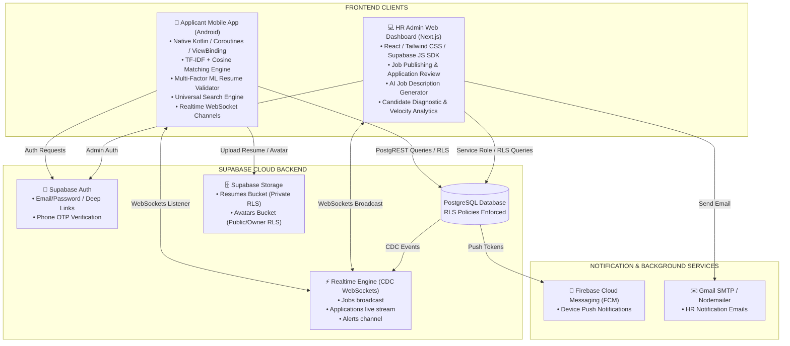
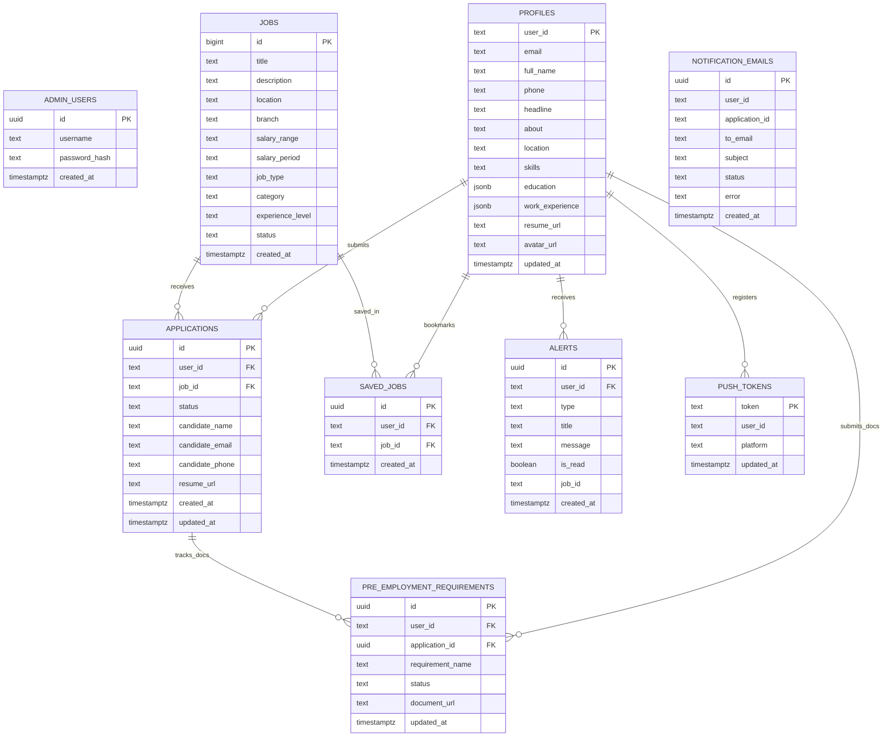

# MR.D.I.Y. Careers — Capstone & Thesis Defense Presentation Guide

> 📖 **Comprehensive Guide & Technical Reference for Capstone Panel Defense**
>
> **Project Title:** MR.D.I.Y. Careers: An Intelligent Mobile Recruitment Portal with Multi-Factor ML Resume Validation, Explainable AI Job Matching, and Real-Time Application Tracking

---

## 1. Capstone Executive Abstract

The **MR.D.I.Y. Careers System** is an end-to-end smart recruitment platform designed to bridge the gap between job applicants and HR administrators. It combines a **Native Kotlin Android Mobile Application** for applicants and a **Next.js Web Admin Dashboard** for HR administrators, powered by a **Supabase PostgreSQL** cloud backend. 

Key technical innovations include:
1. **Multi-Factor ML Resume Validator:** Automatically inspects uploaded resume documents (PDF, DOCX, TXT) across section headers, contact details, employment timelines, and skill density to filter out invalid documents before storage upload.
2. **TF-IDF & Cosine Similarity Job Matching Engine:** Computes profile-to-job text relevance scores ($0-100\%$) with Explainable AI (XAI) outputs (matched skill chips, missing skill suggestions, and match reasons).
3. **Universal Typo-Tolerant Search & Metro Manila Regional Filtering:** Handles misspelled job queries and filters listings within specified geographic branch limits.
4. **Real-Time CDC WebSocket Tracking & Notifications:** Live application status streaming, notification alerts, FCM device tray push tokens, and HR email notification logs.
5. **Pre-Employment Onboarding Checklist:** Interactive compliance tracking for shortlisted/hired applicants.

---

## 2. High-Level System Architecture & Data Flow

---

## 3. Technology Stack & Architectural Justifications

When the panel asks **"Why did you choose these specific tools/frameworks?"**, refer to this table:

| Subsystem | Technology Used | Why Selected? (Panel Justification) |
|---|---|---|
| **Mobile App** | Native Android Kotlin | Native performance, direct Android OS API access (PdfBox, WorkManager, Notification Manager), robust background thread handling via Coroutines. |
| **Admin Web Portal** | Next.js (React) + Tailwind CSS | Fast server-side rendering (SSR), seamless API routes, responsive web interface for HR staff, and instant client-side routing. |
| **Backend & Database** | Supabase PostgreSQL | Open-source Firebase alternative providing relational database structure, native Row Level Security (RLS), instant PostgREST APIs, and built-in Realtime CDC WebSockets. |
| **Security** | Row Level Security (RLS) | Enforces security policies directly at the database layer; applicants can only read/write their own records even if raw API endpoints are queried. |
| **Matching Algorithm** | TF-IDF + Cosine Similarity | Lightweight, mathematical, explainable, and fast algorithm suitable for mobile execution without high latency or heavy GPU server costs. |
| **Text Extraction** | PdfBox-Android | Lightweight native PDF parsing engine running directly on device without sending private candidate documents to 3rd-party cloud OCR APIs. |
| **Push Notifications** | Firebase Cloud Messaging (FCM) | Industry standard for reliable, real-time push notification delivery to Android OS notification tray even when app is closed. |

---

## 4. Machine Learning Algorithms & Mathematical Explanations

### A. TF-IDF (Term Frequency - Inverse Document Frequency)
TF-IDF measures how important a skill or keyword is to a job description relative to the entire catalog of job postings.

$$\text{TF}(t, d) = \frac{\text{Count of term } t \text{ in document } d}{\text{Total terms in document } d}$$

$$\text{IDF}(t, D) = \ln\left( \frac{\text{Total documents } |D|}{1 + \text{Documents containing term } t} \right)$$

$$\text{TF-IDF}(t, d, D) = \text{TF}(t, d) \times \text{IDF}(t, D)$$

### B. Cosine Similarity Score ($0 - 100\%$)
Computes the cosine of the angle between candidate profile term vector $\vec{A}$ and job description term vector $\vec{B}$:

$$\text{Cosine Similarity}(\vec{A}, \vec{B}) = \frac{\vec{A} \cdot \vec{B}}{\|\vec{A}\| \|\vec{B}\|} = \frac{\sum_{i=1}^{n} A_i B_i}{\sqrt{\sum_{i=1}^{n} A_i^2} \sqrt{\sum_{i=1}^{n} B_i^2}}$$

### C. Multi-Factor Resume Validation Signals
Evaluates 4 independent signals before accepting resume upload:
1. **Section Headers Signal:** Matches CV headers (*Experience, Education, Skills, Work History, Projects* in English and Tagalog).
2. **Contact Info Signal:** Detects email formats and Philippine phone patterns (`09xx` / `+639`).
3. **Timeline Signal:** Identifies date ranges (`2020 - 2024`, `Present`, `2 years`).
4. **Skill Vocabulary Signal:** Matches vocabulary in `ResumeSkills.kt` across retail, cashiering, inventory, logistics, and store management.

---

## 5. Entity-Relationship Diagram (Database ERD)

---

## 6. Top 20 Defense Panel Questions & Technical Answers

### Q1: What is the main problem your study addresses?
> **Answer:** Traditional job portals often lack intelligent matching, present static application tracking without real-time updates, and receive non-resume spam files (e.g. recipes, invoices, random notes) that waste HR evaluation time. Our system solves this by introducing on-device multi-factor ML resume validation, explainable TF-IDF job matching, and real-time WebSocket application status tracking.

### Q2: Why did you use TF-IDF and Cosine Similarity instead of Deep Learning / LLMs?
> **Answer:** TF-IDF and Cosine Similarity provide fast, deterministic, explainable, and privacy-preserving calculations directly on the candidate's mobile device without server API costs or GPU requirements. Unlike black-box deep learning models, TF-IDF produces human-readable Explainable AI (XAI) outputs showing exactly which matched skills contributed to the score.

### Q3: How does the Multi-Factor Resume Validation work?
> **Answer:** Before uploading a file to Supabase Cloud Storage, the app extracts text using `PdfBox-Android` and checks 4 independent signals: Section Headers, Contact Details, Timeline/Date Patterns, and Retail Skill Vocabulary. If a document lacks these signals (such as a recipe or invoice), it is rejected on-device before consuming cloud storage bandwidth.

### Q4: How is data privacy and security handled in your database?
> **Answer:** We enforce PostgreSQL **Row Level Security (RLS)** policies on all tables. An applicant can only read and edit their own profile, applications, saved jobs, and uploaded resumes (`auth.uid() = user_id`). The HR Admin uses a secured Service Role connection. Sensitive API keys are never stored in client builds.

### Q5: How does real-time application status tracking work?
> **Answer:** The Android app subscribes to Supabase Realtime WebSocket channels using Postgres Change Data Capture (CDC). When HR changes an application status (e.g., from `Pending` to `Shortlisted` or `Hired`) in the Next.js Admin portal, a WebSocket payload is emitted immediately, updating the applicant's UI badge in real-time without requiring a page refresh.

### Q6: What happens if an applicant uploads a DOCX or TXT file instead of PDF?
> **Answer:** The app supports PDF, DOCX, and TXT formats. Text is extracted locally using specialized parsers, validated through the ML validator, and stored in the private `resumes` bucket under `{user_id}/{filename}`.

### Q7: How does the system handle typos in job searches (e.g., searching for "casher")?
> **Answer:** The `UniversalJobSearchEngine.kt` includes typo-tolerant intent parsing that maps terms like `"casher"` or `"cashiering"` to the primary `"cashier"` occupation family, ranking results with $75\%$ term relevance and $25\%$ candidate profile fit.

### Q8: What is the purpose of the Pre-Employment Onboarding Checklist?
> **Answer:** For candidates who reach "Shortlisted" or "Hired" status, the app provides a compliance checklist (SSS, PhilHealth, Pag-IBIG, NBI Clearance, BIR 1902, Medical Permit, Contract) where applicants can upload proof documents and track HR verification progress.

### Q9: What is the Hiring Velocity Estimator?
> **Answer:** It is a predictive formula in the Admin portal that estimates the days required to complete a hire based on candidate match score ($\ge 85\% \rightarrow -2$ days), profile completeness, pre-employment compliance, and skill gap penalties.

### Q10: How does the system prevent duplicate job applications?
> **Answer:** On the Android client, Kotlin `Mutex` locks (`applyLock`) prevent rapid double-tapping. In the database, a unique index on `(user_id, job_id)` in `public.applications` guarantees single submission per job post.

### Q11: How do push notifications work when the app is closed?
> **Answer:** Upon sign-in, the app registers its FCM token in `public.push_tokens`. When HR updates an application status or publishes a relevant alert, a background notification is dispatched via Firebase Cloud Messaging directly to the candidate's phone tray.

### Q12: How are HR status email notifications handled?
> **Answer:** When HR updates candidate statuses in the Next.js admin portal, `nodemailer` sends a confirmation email via Gmail SMTP, logging the dispatch status (`sent` or `failed`) in `public.notification_emails`.

### Q13: What regional boundaries are enforced for job listings?
> **Answer:** `MetroManilaScope.kt` filters branches and locations within Metro Manila cities (Pasig, Quezon City, Manila, Makati, Taguig, etc.), evaluating branch proximity via `LocationDistance.kt`.

### Q14: How was the system tested and verified?
> **Answer:** We conducted unit testing via `./gradlew.bat :app:testDebugUnitTest` (30 passed unit tests covering search, ML matching, resume validation, and date calculations) and build assembly verification via `:app:assembleDebug`.

### Q15: Why did you choose Supabase over Firebase Realtime Database?
> **Answer:** Supabase uses PostgreSQL, providing a structured relational model with SQL query flexibility, native Row Level Security (RLS), and Postgres CDC WebSockets, whereas Firebase NoSQL lacks complex relational joins and strong schema enforcement.

### Q16: Can an applicant re-upload their resume if they update their skills?
> **Answer:** Yes. Uploading a new resume re-runs the multi-factor validation, replaces the file in Supabase Storage, and automatically merges new skills into `public.profiles`.

### Q17: What is Explainable AI (XAI) and why is it important in recruitment?
> **Answer:** Explainable AI provides human-understandable reasons for algorithm outputs. In our system, XAI displays match badges (*Excellent Match*, *Good Match*), matched skill chips, and missing skill suggestions so applicants and HR understand *why* a candidate received a specific match percentage.

### Q18: How does the AI Job Description Generator assist HR staff?
> **Answer:** In the Next.js Admin portal, HR staff can click `✨ Generate AI Description` when creating a job post. It automatically formats responsibilities, requirements, and benefits tailored to retail roles.

### Q19: What is the significance of the 60-second background catalog refresh?
> **Answer:** If WebSocket connectivity drops temporarily, the mobile ViewModels run a lightweight background refresh cycle to ensure published job catalogs stay synchronized with HR updates.

### Q20: What are the main limitations and future scope of the project?
> **Answer:** Current scope covers Metro Manila retail branch operations, English/Tagalog resume formats, and standardized government compliance checklists. Future expansion includes automated AI video interviews and multi-region geolocation mapping beyond Metro Manila.
