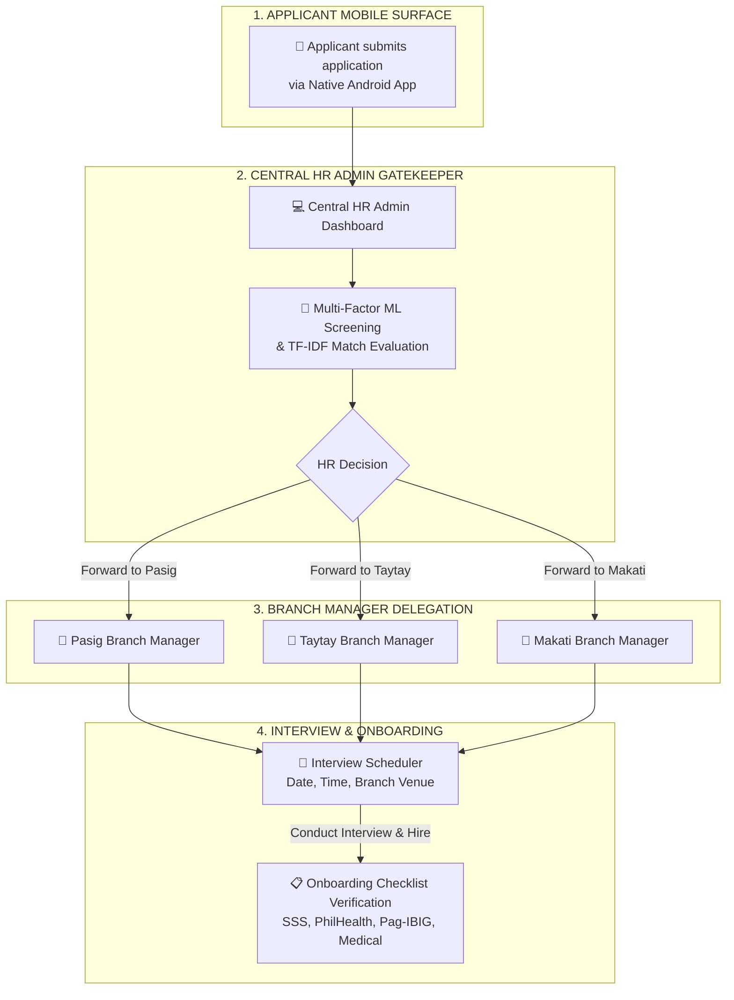
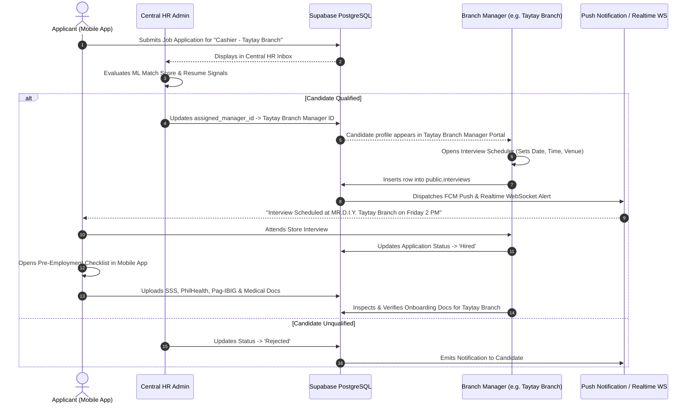
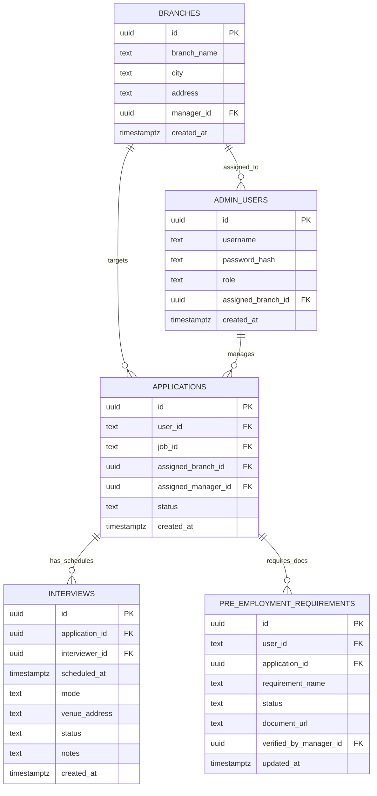

# MR.D.I.Y. Careers — Expanded Multi-Branch Workflow, Manager Routing & Interview Scheduler Blueprint

> 📌 **System Expansion & Defense Architecture Specification**
> 
> **Purpose:** Detailed operational blueprint for Multi-Role HR Admin vs. Branch Manager delegation, Per-Branch Onboarding Verification, and Interview Scheduling.

---

## 1. Executive Scope & System Assessment

### Current Implemented Baseline vs. Expanded Enterprise Workflow

| System Feature | Current Baseline Implementation | Proposed Expanded Enterprise Workflow |
|---|---|---|
| **HR User Role** | Central HR Admin (`public.admin_users`) handles all jobs, applications, and status updates. | **Multi-Role Hierarchy:**<br/>• **Central HR Admin:** Main gatekeeper & application screener.<br/>• **Branch Managers:** Dedicated store-level managers per branch. |
| **Application Routing** | Applications go directly to `public.applications` accessible by Central HR. | **Branch-Level Routing:**<br/>Central HR screens applications $\rightarrow$ Forwards shortlisted candidates to the specific **Branch Manager** assigned to that store location. |
| **Interview Scheduling** | HR sets application status to `Interview Scheduled` via text note. | **Interactive Interview Scheduler:**<br/>Dedicated calendar picker, venue selector (Store Branch or Head Office), mode selector (In-Person / Online), and FCM push invite to applicant phone tray. |
| **Pre-Employment Verification** | Applicant uploads documents; Central HR verifies them. | **Store-Level Onboarding Verification:**<br/>Branch Manager inspects government compliance documents (SSS, PhilHealth, Pag-IBIG, Medical) on day 1 of work and verifies benefits. |

---

## 2. Multi-Role Organizational Workflow & Delegation



---

## 3. Detailed Journey & Data Flow Sequence



---

## 4. Enhanced Database Schema Design

To support per-branch managers, candidate routing, and interview scheduling, the database schema is expanded with the following tables and relationships:



### SQL Table Specifications

```sql
-- 1. Store Branches Table
CREATE TABLE IF NOT EXISTS public.branches (
    id UUID PRIMARY KEY DEFAULT gen_random_uuid(),
    branch_name TEXT NOT NULL,
    city TEXT NOT NULL,
    address TEXT NOT NULL,
    manager_id UUID,
    created_at TIMESTAMPTZ DEFAULT now()
);

-- 2. Enhanced Admin Users Table with Roles
ALTER TABLE public.admin_users 
ADD COLUMN IF NOT EXISTS role TEXT DEFAULT 'HR_ADMIN', -- 'HR_ADMIN' or 'BRANCH_MANAGER'
ADD COLUMN IF NOT EXISTS assigned_branch_id UUID REFERENCES public.branches(id);

-- 3. Applications Table Routing Columns
ALTER TABLE public.applications
ADD COLUMN IF NOT EXISTS assigned_branch_id UUID REFERENCES public.branches(id),
ADD COLUMN IF NOT EXISTS assigned_manager_id UUID REFERENCES public.admin_users(id);

-- 4. Dedicated Interview Scheduler Table
CREATE TABLE IF NOT EXISTS public.interviews (
    id UUID PRIMARY KEY DEFAULT gen_random_uuid(),
    application_id UUID NOT NULL REFERENCES public.applications(id) ON DELETE CASCADE,
    interviewer_id UUID REFERENCES public.admin_users(id),
    scheduled_at TIMESTAMPTZ NOT NULL,
    mode TEXT DEFAULT 'In-Person', -- 'In-Person' or 'Online'
    venue_address TEXT NOT NULL,
    status TEXT DEFAULT 'Scheduled', -- 'Scheduled', 'Completed', 'Rescheduled', 'Cancelled'
    notes TEXT,
    created_at TIMESTAMPTZ DEFAULT now()
);
```

---

## 5. Interview Scheduler Specification

### Admin Web Interface (`mrdiy-admin`)
1. **Calendar Picker Component:**
   - Date picker & Time slot selector (e.g., *October 15, 2026 at 2:00 PM*).
2. **Venue Selector:**
   - Option A: *Branch Store Address* (auto-populated from job branch e.g., *MR.D.I.Y. Taytay Branch, Manila East Road*).
   - Option B: *Head Office / Online Video Link*.
3. **Interviewer Assignment:**
   - Dropdown listing assigned Branch Manager or HR Officer.
4. **Automated Invite Dispatch:**
   - Sends Realtime CDC WebSocket payload + FCM Push Notification + Confirmation Email to candidate.

### Mobile App Surface (`mrdiy-careers`)
1. **Interview Card in `ApplicationsFragment`:**
   - Displays scheduled date, countdown, mode badge (*In-Person / Online*), and branch venue address.
   - One-tap *"Add to Calendar"* / *"View Branch Location Map"*.
2. **Push Notification Banner:**
   - *"MR.D.I.Y. Interview Invitation: Friday Oct 15, 2:00 PM at Pasig Branch."*

---

## 6. How to Present This in Capstone Defense (Panel Script & Strategy)

When the panel asks: **"Does your system handle multi-branch store managers and interview scheduling?"**, use this explanation strategy:

> 🗣️ **Defense Script for Presenters:**
>
> *"Yes, Panel! The system architecture was engineered with a two-tier enterprise recruitment workflow in mind:*
>
> 1. **Central HR Gatekeeper Layer:** All incoming job applications pass through Central HR Admin where our **Multi-Factor ML Resume Validator** and **TF-IDF Cosine Similarity Engine** filter out spam documents and rank qualified applicants.
>
> 2. **Branch Manager Delegation Layer:** Once Central HR shortlists a candidate, the applicant profile is routed to the specific **Branch Manager** assigned to that store (e.g. Pasig or Taytay Branch).
>
> 3. **Store-Level Interview & Onboarding:** The Branch Manager uses the **Interview Scheduler** to invite the applicant to a store interview and verifies their government onboarding requirements (SSS, PhilHealth, Pag-IBIG, Medical) on day 1 of employment.
>
> *Our current functional prototype establishes the core ML engine, real-time WebSocket infrastructure, and database schema, while this blueprint specifies the multi-tenant branch routing for full commercial deployment."*
