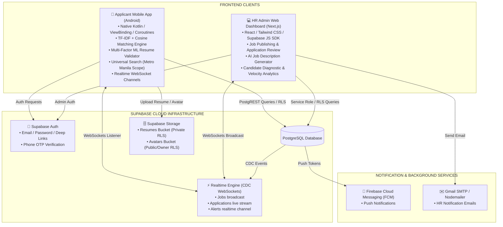
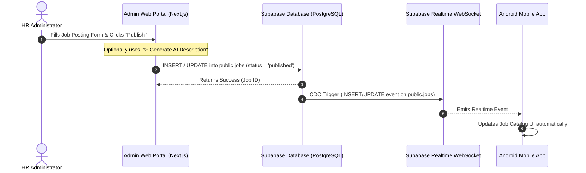
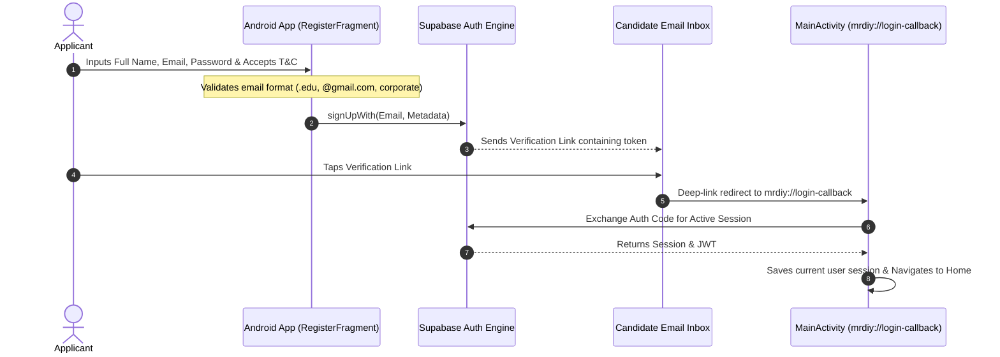
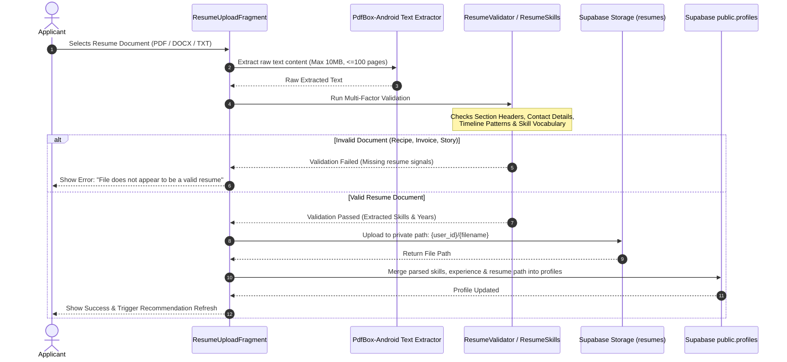
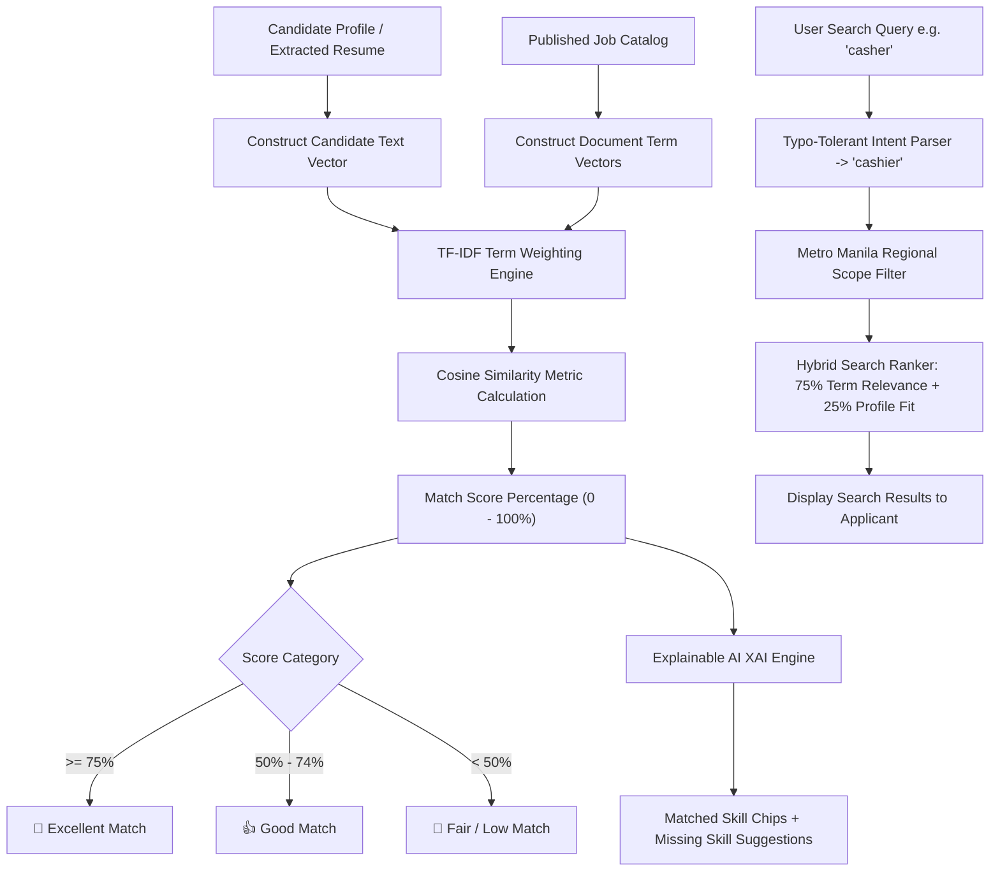
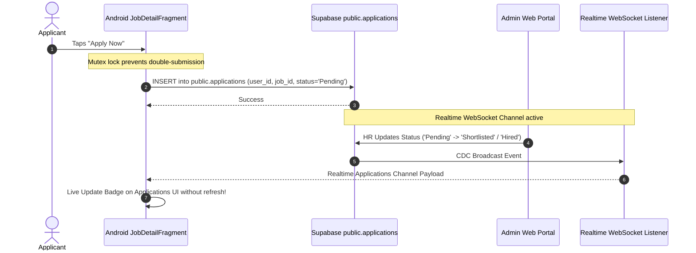
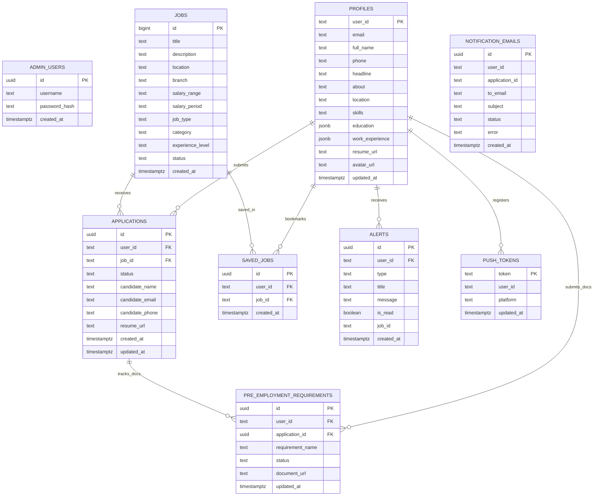

# MR.D.I.Y. Careers — Overall System Architecture & Data Flow

This document details the complete end-to-end system architecture, entity relationships, and operational data flows connecting the **Admin Web Dashboard**, **Android Mobile App**, **Machine Learning Engine**, and **Supabase Backend**.

---

## 1. System Architecture Diagram

---

## 2. Complete End-to-End System Journeys

### Journey 1: HR Admin Posts & Publishes a Job

---

### Journey 2: Candidate Registration & Universal Email Verification

---

### Journey 3: Candidate Uploads Resume & Multi-Factor ML Content Validation

---

### Journey 4: Intelligent Job Matching & Universal Search Engine

---

### Journey 5: Application Submission & Live WebSocket Status Tracker

---

## 3. Entity-Relationship Diagram (Database Schema ERD)

---

## 4. Table of Database Entities & Security Policies

| Table / Bucket | Primary Key / Path | RLS Access Policy | Purpose |
| :--- | :--- | :--- | :--- |
| `public.jobs` | `id` (BigInt/Text) | Read: Public / Applicant Write: Service Role (Admin) | Published job postings catalog |
| `public.profiles` | `user_id` (Text) | Read/Write: Owner (`auth.uid()::text = user_id`) | Candidate profile info, skills, education, experience, avatar |
| `public.applications` | `id` (UUID) | Read/Write: Owner (`auth.uid()::text = user_id`) & Service Role | Submitted job applications & live status tracking |
| `public.saved_jobs` | `id` (UUID) | Read/Write: Owner (`auth.uid()::text = user_id`) | Bookmarked jobs per applicant |
| `public.alerts` | `id` (UUID) | Read/Write: Owner (`auth.uid()::text = user_id`) & Service Role | Notifications and application status alerts |
| `public.pre_employment_requirements` | `id` (UUID) | Read/Write: Owner (`auth.uid()::text = user_id`) & Service Role | Government compliance documents onboarding checklist |
| `public.notification_emails` | `id` (UUID) | Service Role Only | Email delivery logs for HR notification tracking |
| `public.push_tokens` | `token` (Text) | Read/Write: Owner (`auth.uid()::text = user_id`) & Service Role | Firebase Cloud Messaging (FCM) device push tokens |
| Storage: `resumes` | `{user_id}/{filename}` | Read/Write: Owner (`auth.uid()::text = user_id`) | Private uploaded PDF/DOCX/TXT resume files |
| Storage: `avatars` | `{user_id}/{filename}` | Read: Public / Write: Owner | Candidate profile picture uploads |
